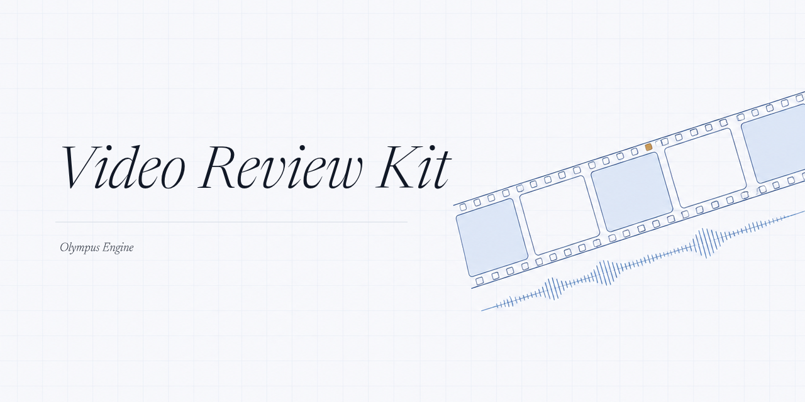
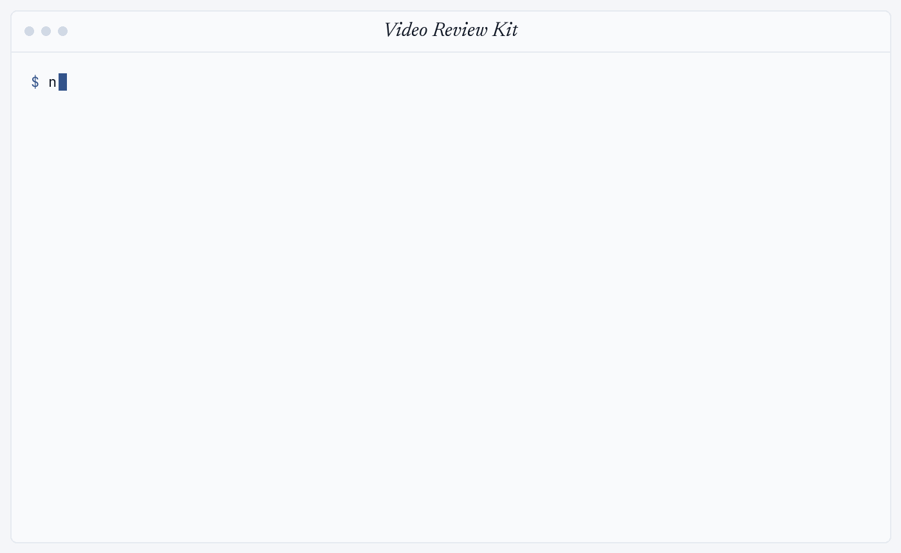

<p align="center">
  
</p>

<p align="center">
  <strong>Let Claude review your videos with the sound on.</strong><br>
  Gemini watches the picture and hears the audio. Claude stays in charge of the conversation.
</p>

<p align="center">
  <a href="LICENSE"></a>
  
  
  
  
  <a href="https://olympusengine.io/care-package/video-review"></a>
</p>

<p align="center">
  
  <br>
  <sub>A real, unedited run on a fresh clone: install, the help text, then one call to Gemini on the 3 second sample clip. The answer quotes the spoken line word for word.</sub>
</p>

---

Claude takes in pictures, not sound, so on a video it only sees a few still frames. This kit hands the whole file, picture and sound together, to Google's Gemini and brings Gemini's read back to Claude. Use it from the command line, or plug it into Claude Code as an MCP tool.

> [!IMPORTANT]
> Read the code before you run it. Whatever you send goes to Google, so read the guide's "Honest limits" section first: **[olympusengine.io/care-package/video-review](https://olympusengine.io/care-package/video-review)**

## Features

| Feature | What it does |
|---|---|
| **Sight and sound** | Sends the whole video to Gemini, so the read covers the audio, not just a few frames. |
| **Two ways in** | `watch.js` on the command line, or `watch-mcp-server.js`, an MCP server named `video-review` with one tool, `watch_media`. Both run the same logic in `watch-core.js`. |
| **Batch or compare** | `--each` sends one request per file, good for scoring a batch. Without it, every file goes in one request for one answer, good for comparing. |
| **Folders work** | A folder expands to the images and videos directly inside it. |
| **JSON on request** | `--json` asks Gemini to reply only with valid JSON. |
| **Large files** | Videos, and any file of 18MB or more, go through Google's Files API. The tool checks every 3 seconds until the file is ready and stops after 8 minutes. |
| **Careful retries** | Only 429 and 5xx errors are retried, up to four more times, waiting 2, 4, 8, then 16 seconds. A 400 or 403 is never retried. |
| **No silent model swaps** | You pick the model. If it fails, the tool says so and names it. It never falls back to another one. |
| **Key stays private** | The key comes only from your environment or the `.env` next to the scripts. It is never printed or logged, and it is scrubbed from error text. |
| **One destination** | It talks only to the Gemini API. No analytics and no other network calls. |

**File types:** images `.png` `.jpg` `.jpeg` `.webp` `.heic` `.heif`, videos `.mp4` `.mov` `.mpeg` `.mpg` `.avi` `.wmv` `.flv` `.webm` `.3gp`.

## Quick start

You need **Node 20 or newer** and a **Gemini API key** from [Google AI Studio](https://aistudio.google.com).

```bash
git clone https://github.com/ase-oe/video-review-kit.git
cd video-review-kit
npm install
cp .env.example .env        # Windows Command Prompt: copy .env.example .env
```

Open `.env` and replace both placeholders:

```ini
GEMINI_API_KEY=your-key
GEMINI_MODEL=a-current-flash-model
```

Pick the model name from [Google's models page](https://ai.google.dev/gemini-api/docs/models). There is no built in default on purpose: model names go stale, and a retired name fails with a 404. Environment variables with the same names win over `.env`. `.gitignore` already lists `.env`, so the key is never committed.

Then run the sample clip that ships in `samples/`:

```bash
node watch.js -q "What is said in this video? Quote it exactly." samples/sample-clip.mp4
```

If the answer quotes the sentence about the blue kite, sight and sound are both working.

<details>
<summary><strong>What is in <code>samples/</code></strong></summary>

- `sample-clip.mp4`: three seconds, a plain title card, and a synthetic voice saying "The blue kite flies over the quiet green hill."
- `sample-image.png`: a red square, a blue square, and the words "RED AND BLUE".

```bash
node watch.js -q "What shapes, colors and words are in this image?" samples/sample-image.png
```

Images work too, though single images are better left with Claude.
</details>

## Command line

```text
node watch.js -q "your question" [--each] [--json] [--model NAME] <file or folder> [more...]
```

| Option | Meaning |
|---|---|
| `-q`, `--question` | Required. What to ask about the files. |
| paths | Required. Files or folders. A folder expands to the images and videos directly inside it. |
| `--each` | One request and one answer per file. Without it, all files go in one request with one answer. |
| `--json` | Adds "Respond only with valid JSON." to the question. |
| `--model NAME` | Uses this model for this call instead of `GEMINI_MODEL`. |
| `-h`, `--help` | Shows the help text. |

```bash
node watch.js -q "Score each video from 1 to 10 on how well the first three seconds stop the scroll, with one line on why." --each /full/path/to/folder
node watch.js -q "List every on-screen text overlay with its start time, end time and exact words." --json /full/path/to/reel.mp4
```

## Connect it to Claude Code (MCP)

Register the server once, for your user, with the full path to the server file:

```bash
claude mcp add --scope user video-review -- node "/full/path/to/video-review-kit/watch-mcp-server.js"
```

Do not put your key in this command. The server reads it from the `.env` file next to the script (found by the script's location, not the folder Claude starts it from) or from your environment.

Quit Claude Code and open it again, since a running session does not pick up a new tool. Check the connection:

```bash
claude mcp get video-review
```

Then ask Claude something like:

```text
Use the watch_media tool on /path/to/reel.mp4. Ask it: "Watch this video with the sound on. Give me a timestamped breakdown of the hook, every cut, every piece of on-screen text, the voiceover and the music." Then give me your notes on what to keep and what to change.
```

| `watch_media` input | Type | Notes |
|---|---|---|
| `question` | string | Required. |
| `paths` | string array | Required. Full paths to files or folders. |
| `mode` | `together` or `each` | Optional. Defaults to `together`. |
| `json` | boolean | Optional. Asks for JSON only. |
| `model` | string | Optional. Overrides the model for this call. |

<details>
<summary><strong>Other MCP clients</strong></summary>

The server speaks MCP over stdio and writes its log lines to stderr. A client that takes the usual JSON config can start it like this, with the key still kept in `.env`, not in the config:

```json
{
  "mcpServers": {
    "video-review": {
      "command": "node",
      "args": ["/full/path/to/video-review-kit/watch-mcp-server.js"]
    }
  }
}
```
</details>

## How it works

```text
your question + files
        │
        ▼
 watch.js (CLI) ─┐
                 ├─► watch-core.js ─► Gemini API ─► text answer
 MCP watch_media ┘     │
                       ├─ image under 18MB: sent inside the request
                       └─ any video, or 18MB+: Files API upload, check every 3s, stop at 8 min
```

- In `each` mode, a failure on one file is reported for that file and the rest still run.
- Errors print as one plain line with no stack trace. The CLI sets its exit code and ends by itself.
- The MCP server talks to Claude over stdio and writes any log lines to stderr.

## When it breaks

| Message | Fix |
|---|---|
| "No Gemini API key found" or "No Gemini model set" | Fill in `.env` as in Quick start. |
| "still the placeholder from .env.example" | Replace the placeholder value in `.env` with your real key or model name. |
| "Gemini rejected the API key" | The key is wrong or was revoked. Make a new one in Google AI Studio. |
| A 404 saying the model is not available | Pick a current model from Google's models page and set `GEMINI_MODEL`. |
| "timeout processing" or "Gemini failed to process" | Try a shorter file, or export it again as a standard MP4. |
| A batch stops with 429 | You probably hit your plan's daily cap. Wait, add billing, or use contact sheets for big image batches. |

More fixes are in the [full guide](https://olympusengine.io/care-package/video-review).

## License

MIT. See [`LICENSE`](LICENSE).

<p align="center">
  <sub>Made by <a href="https://olympusengine.io">Olympus Engine</a></sub>
</p>
